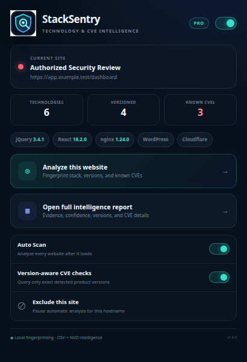
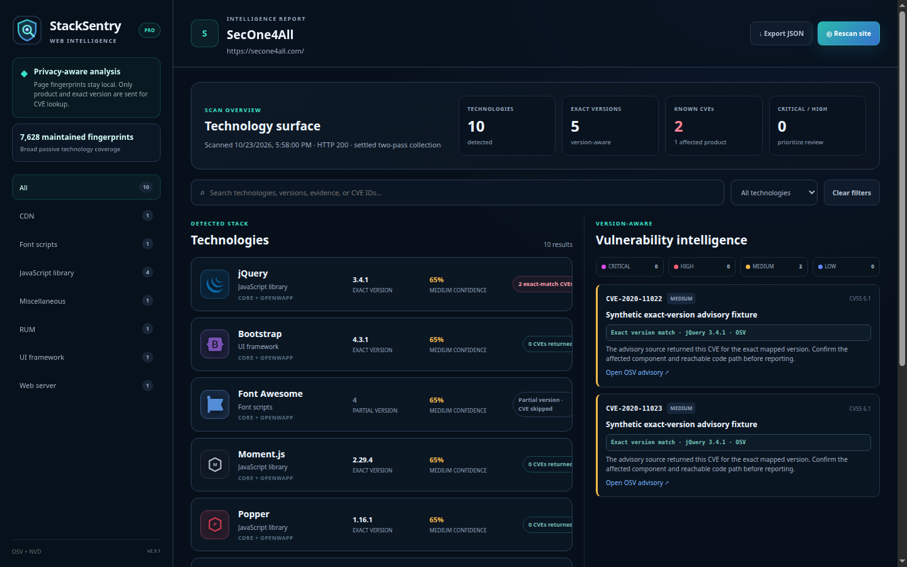

<div align="center">

  

  # StackSentry

  **Automatic web-stack fingerprinting with evidence, exact versions, and version-aware CVE intelligence.**

  [](manifest.json)
  [](#technology-coverage)
  [](manifest.json)
  [](#version-aware-vulnerability-intelligence)
  [](#privacy)

</div>

---

## What it does

StackSentry automatically analyzes each HTTP or HTTPS site after it loads. It
collects non-invasive fingerprints from the DOM, script and stylesheet URLs,
generator metadata, catalog-requested JavaScript properties, page-readable cookie
signals, and observable response headers. Every detection includes its evidence
and confidence score.

When StackSentry finds an **exact version**, it can check that product version
against [OSV.dev](https://osv.dev/) or the
[NIST National Vulnerability Database](https://nvd.nist.gov/). Unknown versions
are never guessed and are never labeled vulnerable.

> [!IMPORTANT]
> A detected technology or advisory match is an investigation lead, not proof
> that a vulnerability is reachable or exploitable. Validate the finding in the
> target's authorized testing scope.

## Screenshots

### Automatic technology and CVE summary



### Full evidence-backed intelligence report



## Features

- **Automatic scanning:** analyzes every normal website after navigation.
- **Settled two-pass collection:** merges immediate and delayed evidence so
  dynamically loaded technologies appear without toggling or reopening the tool.
- **Master On/Off:** stops both automatic and manual analysis and clears badges.
- **Site exclusions:** pauses Auto Scan for selected hostnames and subdomains.
- **Broad maintained catalog:** 7,628 technology fingerprints across 109
  categories, pinned to a reviewed OpenWapp/WebAppAnalyzer dataset revision.
- **Deep passive evidence:** headers, metadata, HTML, visible text, inline
  scripts and styles, asset URLs, dynamic resources, 1,795 catalog-requested
  DOM signals, 5,606 descriptor-safe JavaScript property paths, and all 502
  catalog-requested cookie names.
- **Complete popup inventory:** every detected technology appears in a
  scrollable, category-grouped popup list with its icon, confidence, confirmed
  version, exact CVE status, and matched CVE IDs.
- **Technology icons:** every detected product has a bundled local brand or
  category icon; no remote icon requests are made.
- **Version extraction:** records the version only when a fingerprint exposes it.
- **Strict exact-version gate:** partial versions such as `4` are displayed but
  never sent to OSV/NVD and never used for CVE attribution.
- **Exact-query provenance:** checked results record the OSV package or NVD CPE,
  exact version, source, and check time.
- **Evidence and confidence:** every detection shows why it matched.
- **Live CVE intelligence:** queries exact package versions through OSV and
  mapped server/CMS products through NVD CPE.
- **24-hour local CVE cache:** reduces duplicate requests and browsing overhead.
- **Severity dashboard:** critical, high, medium, and low advisory counts.
- **Local export:** downloads a structured JSON report for later review.
- **Professional dark UI:** compact popup plus a full responsive report workspace.

## Technology coverage

StackSentry combines two local sources:

1. A focused **StackSentry Core** layer for high-value version and protocol
   fingerprints with reviewed OSV/NVD mappings.
2. A pinned **OpenWapp/WebAppAnalyzer** catalog with 7,628 definitions across
   109 categories, including CMS, e-commerce, hosting, web servers, frameworks,
   libraries, analytics, security, payment, advertising, accessibility,
   customer support, maps, media, fonts, databases, and developer tooling.

Overlapping detections are merged into one evidence-backed result. The catalog
is bundled locally and never downloaded while browsing. Coverage is broad, but
no passive browser extension can guarantee identification of every hidden
backend or intentionally obfuscated dependency. DNS-only fingerprints,
certificate-issuer signals, active endpoint probes, and robots-only rules are
outside the passive in-page scan and are not presented as covered.

## Version-aware vulnerability intelligence

StackSentry uses two authoritative sources:

1. **OSV.dev** for exact open-source package versions in ecosystems such as npm,
   PyPI, Packagist, and RubyGems.
2. **NVD 2.0** for exact products that have a reviewed local CPE mapping.

The extension does not send the page URL, DOM, headers, or browsing history to
either service. A request contains only the mapped package/product and exact
version needed for the query.

If a version is missing, ambiguous, or unsupported, the report says so instead
of performing a broad product-name lookup.

## Installation

1. Download and extract [`stacksentry-2.3.1.zip`](dist/stacksentry-2.3.1.zip).
2. Open `chrome://extensions`.
3. Enable **Developer mode**.
4. Select **Load unpacked**.
5. Choose the extracted `stacksentry` folder.
6. Pin StackSentry from Chrome's Extensions menu.

Chrome cannot load the ZIP directly with **Load unpacked**; extract it first.

## Usage

### Automatic mode

1. Keep the master switch and **Auto Scan** enabled.
2. Visit a normal HTTP or HTTPS website.
3. Wait for the page to finish loading.
4. The badge shows the number of detected technologies.
5. Open the popup for the summary or select **Open full intelligence report**.

### Manual scan

Open the popup and select **Analyze this website**, or press `Alt+Shift+S` to
scan and open the report.

### Pause the extension

- Use the top-right master switch to turn StackSentry completely off.
- Use **Auto Scan** to keep manual scans available while stopping navigation scans.
- Use **Exclude this site** to pause only the current hostname and its subdomains.

## Permissions

| Permission | Purpose |
|---|---|
| `activeTab`, `tabs` | Identify the current tab and maintain per-tab results |
| `scripting` | Collect page fingerprints after navigation or a manual scan |
| `webRequest` | Observe non-sensitive response headers without modifying traffic |
| `storage` | Save settings, exclusions, temporary reports, and the CVE cache |
| HTTP(S) host access | Analyze normal websites and query OSV/NVD |

StackSentry never blocks, redirects, or modifies network requests.

## Privacy

- Page fingerprinting runs inside the browser.
- Page HTML is sampled in memory and is not persisted in reports.
- Cookies and `Set-Cookie` headers are intentionally not collected.
- Only exact product/package names and versions are sent to OSV or NVD.
- CVE results are cached locally for 24 hours.
- No analytics, telemetry, account, or remote StackSentry service is used.

## Accuracy boundaries

- Websites can hide or remove version information.
- Reverse proxies may expose their own server header instead of the origin stack.
- Build tools can rename, bundle, or remove recognizable asset fingerprints.
- A CVE match means the reported version is listed as affected; it does not prove
  the vulnerable code path is enabled or reachable.
- Client-side inspection cannot reliably identify every backend component.

## Development

```bash
npm install --ignore-scripts
npm run check
npm run audit:cve
npm run build
```

The check suite validates manifest assets, JavaScript syntax, positive and
nearby-negative fingerprints, all 7,628 local catalog icons, catalog/core
deduplication, exact-version OSV/NVD normalization, the master switch, storage,
and Chrome event registration.

`npm run audit:cve` is a separate live-provider smoke test. It compares a known
vulnerable jQuery release with its fixed release, proves partial versions never
leave the browser, and validates an exact NVD CPE query.

## License

StackSentry v2 is distributed under GPL-3.0 because it bundles the maintained
GPL-3.0 OpenWapp/WebAppAnalyzer fingerprint dataset. The complete pinned
fingerprint source and all dependency notices are included in the release.

## Documentation

- [Detailed documentation](DOCUMENTATION.md)
- [Plain-text guide](DOCUMENTATION.txt)
- [Changelog](CHANGELOG.md)
- [Release ZIP](dist/stacksentry-2.3.1.zip)
- [Third-party notices](THIRD_PARTY_NOTICES.md)

---

<div align="center">
  <strong>StackSentry v2.3.1</strong><br>
  Evidence first. Exact versions. Honest vulnerability intelligence.
</div>
